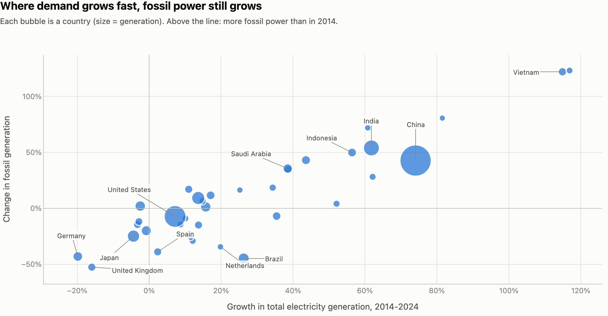
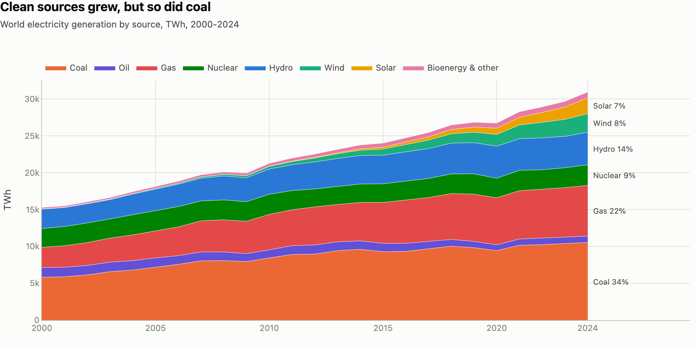
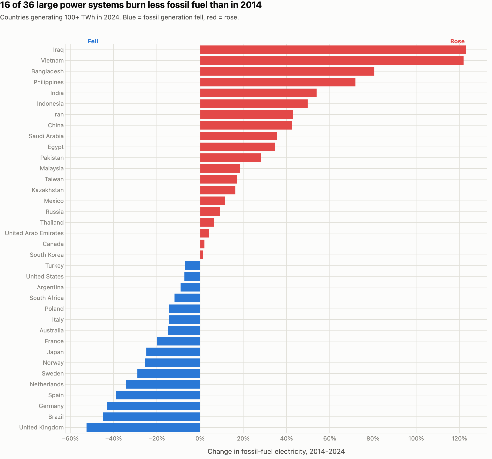

# The Energy Transition in 7 Charts: An Interactive Data Story

**Live page: [sahityasetu.github.io/energy-transition-data-story](https://sahityasetu.github.io/energy-transition-data-story/)**

Solar and wind went from 4% to 15% of the world's electricity between 2014 and 2024, yet fossil-fuel generation is still higher than in 2014. This project turns 25 years of country-level energy data into an interactive data story that explains both facts at once.

   



## Key findings (2014 to 2024)

| Metric | 2014 | 2024 |
|---|---|---|
| Low-carbon share of world electricity | 32.8% | 40.9% |
| Solar + wind share | 3.8% | 15.0% |
| CO₂ per kWh generated | 545 g | 471 g (-14%) |
| Fossil-fuel electricity | 15,962 TWh | 18,276 TWh (+14%) |

1. **Low-carbon sources covered about 68% of the world's new electricity demand.** The other 32% still came from fossil fuels, so fossil generation kept rising.
2. **The 36 large power systems (100+ TWh) split into two groups.** 16 burn less fossil fuel for power than in 2014 (UK -53%, Brazil -45%, Germany -43%). 20 burn more.
3. **Demand growth explains the split.** Countries that cut fossil power grew total generation by a median of 8%; countries where fossil power rose grew by 41%. Correlation between demand growth and fossil change: 0.90.
4. **India:** generation grew 62%. Solar rose from 5 to 143 TWh, but low-carbon sources met only about 29% of the new demand, so fossil generation still rose 54%. Coal's share is unchanged at about 75%.

Every number in the story text is computed in code from the data ([`reports/facts.json`](reports/facts.json)), so nothing is typed in by hand and the page updates when the source data updates.

## The charts

| # | Chart | Why this form |
|---|---|---|
| 1 | World generation by source, 2000-2024 (stacked area) | part-to-whole over time, direct labels at the end |
| 2 | Change in fossil generation by country (diverging bar) | sign matters: fell vs rose, sorted |
| 3 | Demand growth vs fossil change (bubble scatter) | the relationship behind chart 2 |
| 4 | Solar + wind share 2014 vs 2024 (dumbbell) | before/after for 15 countries without clutter |
| 5 | Low-carbon share map (choropleth) | geography, one-hue scale |
| 6 | India spotlight (100% stacked area) | how the mix shifted, not just the size |
| 7 | Explore any country (dropdown) | lets readers check their own country |




## Design choices

- **Titles state the finding** ("Where demand grows fast, fossil power still grows"), not just the topic.
- **Colour-blind check:** the 8 source colours were tested for colour-vision-deficiency separation in stack order; three light colours get direct labels so colour is never the only cue.
- **One axis per chart**, no dual axes; diverging colours only where the sign means something (blue = fell, red = rose).
- **Hover tooltips** on every chart show the exact TWh values; a CSV of the country table is in [`reports/`](reports/).

## How to run

```bash
python -m venv .venv && source .venv/bin/activate
pip install -r requirements.txt
python -m src.build_story   # downloads the data (~9 MB), writes docs/index.html and reports/figures/*.png
pytest -q                   # 4 tests
open docs/index.html
```

## Project structure

```
├── src/data.py          # download, clean, country change table, world KPIs
├── src/charts.py        # one Plotly function per chart, shared style
├── src/build_story.py   # computes facts, assembles docs/index.html, exports PNGs
├── tests/               # unit tests for the data logic
├── docs/index.html      # the published story (GitHub Pages)
└── reports/             # facts.json, country table CSV, PNG previews
```

## Data and caveats

[Our World in Data energy dataset](https://github.com/owid/energy-data) (based on Ember and the Energy Institute Statistical Review). 2025 is excluded because only about half of countries have reported it. Country comparisons use countries generating at least 100 TWh in 2024. Correlation is not causation: weather, hydro years and fuel prices also move these numbers, and fossil change is partly linked to demand growth by construction.
